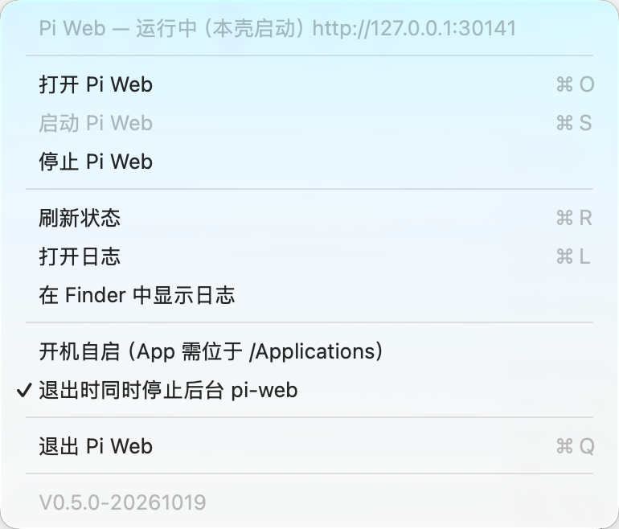
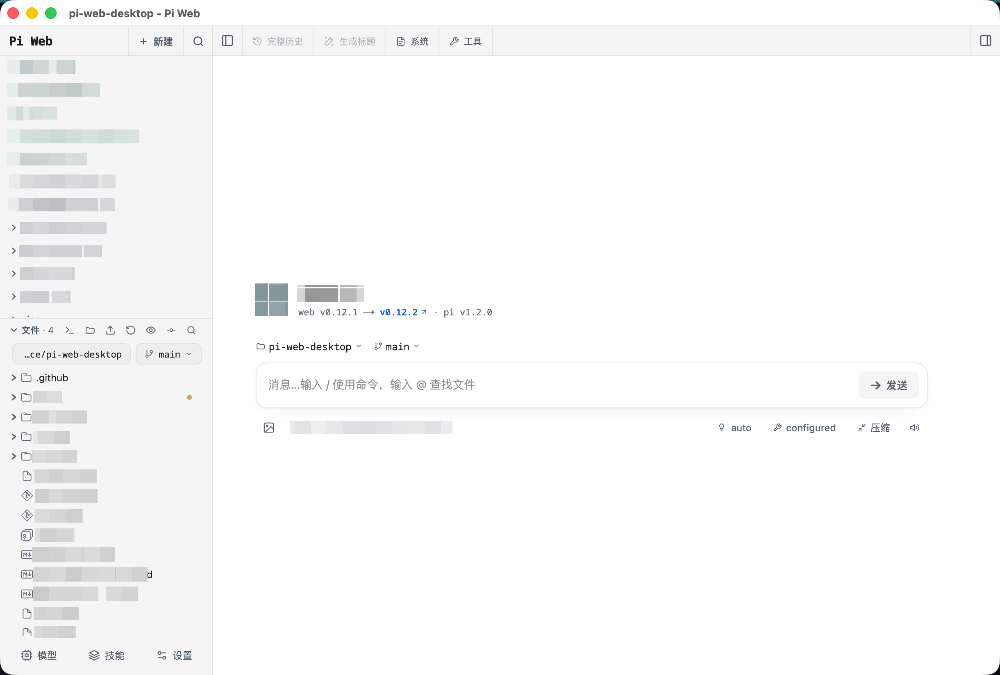

# Pi Web Desktop (macOS)

A tiny native macOS menu bar launcher for the **pi-web** web UI: it detects, reuses, starts, opens and stops a local `pi-web` instance without a terminal.

**English** · [简体中文](README.zh-CN.md)

[](https://github.com/bestxia0/pi-web-desktop-macos/actions/workflows/ci.yml)
[](LICENSE)
[](#requirements)
[](#requirements)
[](#requirements)
[](https://github.com/bestxia0/pi-web-desktop-macos/releases)


*Pi Web in the menu bar: an SF Symbol plus a short `Pi` title, tinted by launcher state.*

## What it is / What it is not

| What it is | What it is not |
| --- | --- |
| A native Swift + AppKit `NSStatusItem` menu bar app (`LSUIElement`, no Dock icon) | A browser or Electron shell — it owns its own single native window with multiple `WKWebView` tabs and never embeds a browser engine |
| A **launcher only**: it finds, starts and stops the `pi-web` CLI for you | A bundler — it never ships Node, npm or the `pi-web` package |
| A front end for the `pi-web` server on `127.0.0.1` | A replacement for `pi-web`; the CLI and `node` must already be installed |
| A **zero-dependency** app built with `swiftc` alone | A user of SPM, CocoaPods or any third-party package |

## The four specific annoyances it removes

- **You do not want to open a terminal to get to the UI.** Tap the **right Option** key to toggle the window, or click the menu bar icon.
- **You do not want a second server instance.** Every launch reads `pi-web`'s own run records first and **attaches** to a healthy instance instead of starting another one.
- **You do not want a crash when the port is taken.** `pi-web` has no port fallback of its own (it exits with "Next.js exited unexpectedly" if `30141` is busy); this shell picks a free port before spawning.
- **You want to know what you are stopping.** Instances this shell started get a signal escalation; instances started elsewhere (say, in a terminal) require a confirmation and are stopped through the upstream `pi-web stop --port N`.

## Scenario 1 · Install it once (about 5 minutes)

1. **Install the runtime.** You need a global `pi-web` and `node`:

   ```sh
   brew install node
   npm install -g @agegr/pi-web
   pi-web --version        # should print a version, e.g. 0.12.2
   ```

2. **Build the app.** Only Xcode Command Line Tools are needed:

   ```sh
   git clone https://github.com/bestxia0/pi-web-desktop-macos.git
   cd pi-web-desktop-macos
   ./build.sh              # swiftc + assemble build/PiWeb.app + code-sign
   open build/PiWeb.app
   ```

   `./build.sh --run` builds and launches in one step. The bundle is a **universal arm64 + x86_64 binary**, so it runs on Apple silicon and Intel Macs alike.

3. **`make install` (optional but recommended).** Copy the app to `/Applications`:

   ```sh
   make install            # = ./scripts/install.sh
   ```

   Start at Login (`SMAppService.mainApp`) needs a stable bundle location, so install to `/Applications` before enabling it.

4. **Grant Input Monitoring (only needed for the right-Option hotkey).** If the first right-Option tap does nothing, click `⚠︎ 需要「输入监控」权限——点击授权` in the menu and tick the app in System Settings → Privacy & Security → Input Monitoring.

5. **Enable Start at Login if you want it.** The `开机自启` checkbox always reflects the real system status.

Acceptance: a `Pi` icon appears in the menu bar; the menu's first row is `Pi Web — <state>`, its last row is `V<version>-<build date>`, and `打开 Pi Web` works.

## Scenario 2 · Daily use: open, add a tab, close

- **Open / hide**: tap the **right** Option key, or click the menu bar icon → `打开 Pi Web` / `显示 / 隐藏窗口`. The window is created once: opening it again only focuses it, keeping scroll position, back/forward state and tabs.
- **A new tab**: the `+` at the right of the tab bar, ⌘T, or the `新建标签页` menu item. A new tab loads the session list — scoped to the active tab's `cwd` when it has one, unscoped otherwise — and never creates a session server-side.
- **One tab per project**: every tab is an independent `WKWebView`, so tabs can point at different sessions (`?session=<id>`) or different working directories.
- **Colour a tab**: right-click a tab → `颜色` (无颜色, 红, 橙, 黄, 绿, 薄荷, 蓝, 靛蓝, 紫, 粉, 灰), plus `关闭标签页` and `关闭其他标签页` in the same menu.
- **Close**: ⌘W closes the **current tab**; closing the last tab only hides the window. The red close button and the right-Option hotkey act on the whole window (hide, never destroy).


*What the menu looks like open (this capture is from v0.5.0: after the tab and hotkey work in 0.6.0/0.7.0 the menu also has `新建标签页`, `标签页`, `右侧 Option 唤起窗口` and more).*

## Scenario 3 · pi-web is already running in a terminal

Detect first, decide second:

1. Read `<agentDir>/pi-web-run/*.json` (`agentDir` is `PI_CODING_AGENT_DIR`, default `~/.pi/agent`).
2. Validate that `pid` is alive **and** really ours (`ps -ww -p <pid> -o args=`: the launcher's arguments contain `pi-web`, the next process's contain `next`; a record whose launcher is gone but whose next process lives is an *orphan*).
3. **Only then** probe the URL (any HTTP status counts as an answer, including the 401 of a password-protected `pi-web`).

The order matters: a stale record can point at a URL that answers instantly because another instance owns that port, and probing URLs first would count two live instances.

So: if a healthy `pi-web` already runs in your terminal, the shell **attaches** to it and points the window at it, and never starts a second one. Detection is **read-only** — this shell never deletes your run records (upstream's own `listRunRecords` prunes them; we deliberately do not).

To see the decision for yourself:

```sh
build/PiWeb.app/Contents/MacOS/PiWeb --probe
pi-web status          # upstream's own instance list, for comparison
```

## Scenario 4 · Stopping and quitting

Two paths, depending on who started the instance:

| Path | Mechanism | Escalation | Confirmation |
| --- | --- | --- | --- |
| Owned (started by this shell) | Signals the child directly | `SIGINT` (10s) → `SIGTERM` (5s) → `SIGKILL` | None |
| Attached (started elsewhere) | Delegates to upstream `pi-web stop --port N` | Upstream's business | Yes, a modal warning |

- `SIGINT` goes first because Next.js holds SSE connections open and its `instrumentation-node.ts` closes them on SIGINT/SIGTERM, so `pi-web` exits cleanly.
- Attached stops always pass `--port N` (without it upstream errors out when several instances run) and ask first, because that instance may be the session you are using in a terminal.
- With several instances running, `停止 Pi Web` becomes `停止 Pi Web（N 个实例）` with one entry per instance: `<url>  pid <pid>（本壳）`.
- Every stop re-detects afterwards, so the menu always reflects reality.
- On quit, the `退出时同时停止后台 pi-web` checkbox (default **on**) decides whether **attached** instances are stopped too; children this shell started are always stopped.

## Scenario 5 · When something is wrong

| Symptom | Likely cause | One-shot fix |
| --- | --- | --- |
| No icon in the menu bar | The icon is hidden in the menu bar overflow area / behind the notch, or another instance holds the single-instance lock | Check the overflow area and Activity Monitor for `PiWeb`; launching the app again makes the running instance pop its menu. Read `~/Library/Logs/PiWeb/pi-web.log`. |
| "pi-web not found" after launching from Finder | LaunchServices gives the app only `/usr/bin:/bin:/usr/sbin:/sbin`, and the login-shell probe failed or timed out (a slow `.zshrc`) | Install `pi-web` globally, verify with `/bin/zsh -lic 'command -v pi-web'`, then set `PiWebExecutablePath` or `PI_WEB_DESKTOP_EXECUTABLE`. Diagnose with `--resolve` / `--probe`. |
| The preferred port is taken | `pi-web` has no fallback and exits with "Next.js exited unexpectedly" | Let this shell use `30151+` or an ephemeral port (the status row shows the real URL); find and stop the stale instance with `停止 Pi Web` or `--probe`. |
| A second launch seems to do nothing | LaunchServices de-duplicates bundle launches; the running instance receives an activate notification and pops its own menu | Click the menu bar icon; if that still does nothing, confirm the running instance through the log and the status row. |
| The login item points at the repository | The `.app` is not in `/Applications`, so `SMAppService.mainApp` registered the repository path | Run `make install` first, then enable `开机自启`; until then the menu shows `开机自启（App 需位于 /Applications）`. |
| The pi-web UI opens in the default browser instead of the app window | This only affects the headless `--open-url` fallback: none of the four canonical Chrome-family apps was found in `/Applications` | Install Google Chrome, Microsoft Edge, Brave or Arc, or accept the default browser. The GUI always uses its native window. |
| The start flow ends in “启动失败” | The `pi-web` process exited early (port clash, missing Node, …) | The menu shows the failure reason and the log tail carries the child's stdout/stderr; `--resolve` prints the resolved `pi-web`, its source and the child `PATH`. |

### Input Monitoring grant gone stale (30-second fix)

The right-Option hotkey is gated by the macOS **Input Monitoring** permission, and that grant is bound to the code signature, so it can go stale silently.

**Why it breaks.** The default build is ad-hoc signed (`codesign --sign -`) and gets a **new cdhash on every rebuild**; moving the `.app` is also an identity change. TCC still holds the old build's requirement, so the System Settings checkbox can read **on** while the hotkey is already dead. The log shows `Failed to match existing code requirement for subject com.piweb.desktop`.

**30-second fix:**

```sh
/usr/bin/tccutil reset ListenEvent com.piweb.desktop
/usr/bin/tccutil reset Accessibility com.piweb.desktop   # if Accessibility was granted too
```

Restart the app, click `⚠︎ 需要「输入监控」权限——点击授权` in the menu, tick the app, and switch the hotkey back on. The `重置「输入监控」授权并重新请求` menu item performs the same reset and re-request from inside the app.

**The permanent fix: a stable self-signed certificate.** Create it once in **Keychain Access**:

1. Keychain Access → Certificate Assistant → Create a Certificate…
2. Name: `PiWeb Local Signing` (exactly)
3. Identity Type: Self Signed Root
4. Certificate Type: Code Signing
5. Validity: `3650` days or more → Create
6. Open the new certificate → Get Info → Trust → set “Code Signing” to “Always Trust”

After that `./build.sh` picks it up automatically: first `$PI_WEB_SIGN_IDENTITY`, otherwise an exact `PiWeb Local Signing` match from `security find-identity -v -p codesigning`, and it prints `signed (identity: PiWeb Local Signing)` plus the `CDHash`. With no usable identity it falls back to ad-hoc and warns explicitly. **After switching signing identities** run the TCC reset and re-grant once more.

> If `codesign` raises a keychain authorization dialog, choose “Always Allow” once; refusing or cancelling makes this build fall back to ad-hoc signing (`build.sh` falls back automatically and warns).

## Scenario 6 · Upgrading and uninstalling

- **From a release**: download `PiWeb-<version>.zip` from [Releases](https://github.com/bestxia0/pi-web-desktop-macos/releases) (universal arm64 + x86_64), unzip it over `/Applications/PiWeb.app`, then restart the app. An un-notarised download needs one Gatekeeper confirmation on first launch.
- **From source**: `git pull` then `make install` (or just `./build.sh` and use the repository's `build/PiWeb.app`).
- **Uninstall**: `make uninstall` removes `/Applications/PiWeb.app` and quits a running instance.
- **Leftovers (delete by hand if you want them gone)**: preferences `defaults delete com.piweb.desktop`, logs `~/Library/Logs/PiWeb/`, single-instance lock `~/Library/Application Support/PiWeb/`.
- **Automatic update check**: not implemented yet (see the [roadmap](#roadmap)). The `pi-web` CLI can check its own version with `pi-web update --check`.

## Screenshots


*The `pi-web` console UI rendered in one of the app's own native `WKWebView` tabs.*

## Requirements

- **macOS 13.0 or later** (`LSMinimumSystemVersion` is `13.0`; `SMAppService` needs macOS 13).
- **Xcode Command Line Tools** (they provide `swiftc`, `lipo`, `sips` and `iconutil`) — the only build tool needed.
- To actually start the server: a **globally installed `pi-web` CLI** and **`node`** on the `PATH`.

No SPM, no CocoaPods, no third-party packages. The app compiles against system frameworks only (Foundation, AppKit, WebKit, CoreGraphics, ApplicationServices, ServiceManagement, UniformTypeIdentifiers).

## Reference

### Menu reference

All UI text is Simplified Chinese; the table lists the items top to bottom.

| Menu item | What it does | State / condition |
| --- | --- | --- |
| `Pi Web — <detail>` | The status row at the top: current phase, active URL/version or instance count. | Always present, disabled (display only). |
| `错误：<message>` | Shows the most recent failure (newlines are collapsed). | Only present while an error is set. |
| 打开 Pi Web | Shows the app's own single native window (creating it if needed) and restores the persisted tabs. Key equivalent `O`. | Enabled only when an active instance URL is known. |
| 显示 / 隐藏窗口 | Toggles the single native window: hides it when visible and frontmost, otherwise shows and focuses it. | Enabled when an active instance URL is known or the window already exists. |
| 新建标签页 | Creates a native tab by hand (the `+` at the right of the tab bar, or ⌘T in the real main menu). Without an explicit URL it loads the session list, scoped to the active tab's `cwd` when it has one; it never creates a server-side session. | Always enabled. |
| 关闭标签页 | Closes the current tab; when it was the last one the window hides (`orderOut`). | Enabled with at least one tab. |
| 下一个标签页 | Selects the next tab (wrapping). | Enabled with more than one tab. |
| 上一个标签页 | Selects the previous tab (wrapping). | Enabled with more than one tab. |
| 标签页 | Submenu listing every open tab (`<n> <title>`); selecting one focuses it, the current one is checkmarked. | Disabled with no tabs. |
| 启动 Pi Web | Detects first: attaches to an existing instance, otherwise starts one on a free port with `--no-open` and opens it. Key equivalent `S`. | Enabled only while the launcher is stopped or failed. |
| 停止 Pi Web | Stops the instance. Owned → `SIGINT → 10s → SIGTERM → 5s → SIGKILL`; attached → upstream `pi-web stop --port N` after a confirmation. | Enabled with exactly one live instance. With several it becomes `停止 Pi Web（N 个实例）` with a per-instance submenu (owned entries read `<url>  pid <pid>（本壳）`). |
| 刷新状态 | Re-runs detection and rebuilds the menu. Key equivalent `R`. | Always enabled. |
| 打开日志 | Opens `~/Library/Logs/PiWeb/pi-web.log`. Key equivalent `L`. | Always enabled. |
| 在 Finder 中显示日志 | Reveals the log file in Finder. | Always enabled. |
| 开机自启 | Registers/unregisters the login item through `SMAppService.mainApp`. | The checkbox reflects the real state; when approval is needed the title is `开机自启（需在系统设置中批准）`, when the bundle is not installed it is `开机自启（App 需位于 /Applications）`, and when unsupported it shows `开机自启不可用：<reason>` disabled. |
| 退出时同时停止后台 pi-web | Toggles whether quitting also stops attached instances. Persisted in the UserDefaults key `PiWebStopAttachedOnQuit`. | Checkbox, default **on**. Always enabled. |
| 右侧 Option 唤起窗口 | Checkbox: enables/disables the right-Option global hotkey. Persisted in the UserDefaults key `PiWebHotKeyEnabled`. | Checkbox, default **on**. Toggling starts/stops `HotKeyMonitor` immediately. |
| 退出 Pi Web | Stops the owned child (plus every attached instance when the toggle is on), then quits. Key equivalent `Q`. | Always enabled. |
| ⚠︎ 需要「输入监控」权限——点击授权 | Requests Input Monitoring (`CGRequestListenEventAccess`) and opens System Settings > Privacy & Security > Input Monitoring. | Only while Input Monitoring is missing, just above the version row. |
| 重置「输入监控」授权并重新请求 | Clears the stale TCC entry (`tccutil reset ListenEvent com.piweb.desktop`), then requests the grant again and opens System Settings. For "the checkbox is on but the hotkey is dead after a rebuild/move". | Right after the grant item, only while Input Monitoring is missing. |
| `V<semver>-<builddate>` | The launcher version, e.g. `V0.8.0-20261025`. | Always present, disabled (display only), last row. |

### Status icon

Status icons are drawn by `MenuController.updateIcon()`: an SF Symbol plus the short `Pi` title, tinted by state.

| State | Symbol | Colour |
| --- | --- | --- |
| Running | `play.circle.fill` | Green |
| Starting / stopping (busy) | `arrow.triangle.2.circlepath` | Orange |
| Stopped | `power.circle.fill` | Label colour |
| Failed | `exclamationmark.triangle.fill` | Red |

### Native window, tabs and the right-Option hotkey

The UI renders in **one** native `NSWindow` (`AppWindowController`) with a native tab strip on top and one independent `WKWebView` per tab, created on first use and reused afterwards:

- Clicking `打开 Pi Web` again or tapping the hotkey only focuses the window; it never creates a second one. The first show restores tabs from `UserDefaults`.
- The **red close button** and the **right-Option hotkey** hide the whole window (`orderOut`) and never destroy it, so reopening is instant.
- The hotkey can also reveal the window when no instance URL is currently detected but tabs are still open.
- `⌘W` closes the **current tab**; closing the last tab hides the window.
- Links whose host is not `127.0.0.1`/`localhost` open in the system browser.
- Persistence: each tab's URL + colour and the selected index live in `UserDefaults` (`PiWebTabs` / `PiWebTabsSelected`). On the next launch every stored URL's scheme/host/port is rewritten onto the current pi-web base (the port can change), preserving path, query and fragment.

The hotkey uses a listen-only `CGEvent` tap (`flagsChanged`) and falls back to `NSEvent` global/local monitors when the tap cannot be created. It accepts the right Option key only (keyCode `61`), ignores left Option (`58`) entirely, and **never consumes events**, so right Option still works as a normal modifier in other apps.

### Main-menu shortcuts

Browser-style shortcuts live in the real `NSApp.mainMenu` (`MainMenu.swift`), because a status-item menu's key equivalents only fire while that menu is open.

| Shortcut | Action |
| --- | --- |
| ⌘T / ⌘W | New tab / close the current tab |
| ⌘⇧] / ⌘⇧[ | Next / previous tab |
| ⌘1…⌘9 | Select tab N |
| ⌘[ / ⌘] | Back / forward |
| ⌘R | Reload |
| ⌘Z / ⌘X / ⌘C / ⌘V / ⌘A | Standard editing (applies to the focused web input field) |
| ⌘H / ⌥⌘H / ⌘Q | Hide / hide others / quit |

### Headless and verification flags

The same binary runs headless, so detection, start/stop and port fallback can be verified without a display:

```sh
BIN=build/PiWeb.app/Contents/MacOS/PiWeb

$BIN --self-test                                # assertions: run-record parsing + stale-record logic + PATH/node resolution
$BIN --probe                                    # print every run record, its classification and the attach/start decision
$BIN --test-cycle --port 30199                  # start on 30199, wait for readiness, then stop
$BIN --test-cycle --occupy --port 30199         # occupy 30199, then start on the fallback port
$BIN --test-cycle --gui-path --port 30199       # end-to-end with LaunchServices' (system default) PATH
$BIN --test-fallback --port 30199               # show which port the planner picks when 30199 is taken
$BIN --open-url http://127.0.0.1:30141          # open an app-mode window
$BIN --resolve [--gui-path]                     # print the resolved pi-web + source + child PATH + node
$BIN --stop-port 30199                          # stop one instance through upstream `pi-web stop --port 30199`
$BIN --test-quit --port 30199                   # rehearse stopForQuit (attached instances are stopped)
$BIN --test-quit --port 30199 --keep-attached   # same, with the toggle off
$BIN --port 30199                               # override the preferred port
$BIN --version                                  # print the exact string the menu's bottom row shows
$BIN --log-path                                 # print the log file path
```

| Flag | What it does | Notes |
| --- | --- | --- |
| `--self-test` | Runs the built-in assertions (run-record parsing, stale/orphan records, PATH/node resolution, stop command, stop menu, tab arithmetic, version composition). | Exits non-zero if any check fails. Verification only. |
| `--probe` | Prints every run record with its step-2/step-3 classification, then the attach/start decision. | Read-only; never deletes records. Verification only. |
| `--test-cycle [--occupy] [--gui-path]` | Runs a full start → ready → stop cycle against a throwaway instance. | `--occupy` pre-occupies the preferred port to exercise the fallback; `--gui-path` forces the system default PATH. Verification only. |
| `--test-fallback` | Occupies the preferred port and reports the fallback port the planner would choose. | Verification only. |
| `--open-url <url>` | Opens a URL through `BrowserOpener` (Chrome-family app mode, else the default browser) and prints the command used. | Headless fallback only; the GUI uses its native window. |
| `--resolve [--gui-path]` | Prints the resolved `pi-web`, its source, the child PATH, `node`, the run directory and the browser plan. | `--gui-path` bypasses every cache and forces a probe. |
| `--stop-port <n>` | Stops one instance through upstream `pi-web stop --port n` and prints the detection before and after. | Verification only. |
| `--test-quit [--keep-attached]` | Rehearses `stopForQuit`, scoped to `--port`. | `--keep-attached` simulates the toggle being off. Verification only. |
| `--port <n>` | Overrides the preferred port. | Also settable through `PI_WEB_DESKTOP_PORT`; `--port` wins. |
| `--version` | Prints the version string the menu's bottom row shows. | —— |
| `--log-path` | Prints the log file path. | —— |

> `--stop-port`, `--test-cycle`, `--test-fallback` and `--test-quit` are **verification only** and are not part of the normal menu flow. `--test-cycle` never touches the `30141` instance: it only signals the child it spawned.

### How detection works (reusing the pi-web contract)

Run records live at `<agentDir>/pi-web-run/<launcherPid>.json`, where `agentDir` is `PI_CODING_AGENT_DIR` (expanding `~` / `~/` / `file://`) or `~/.pi/agent`. This shell reuses pi-web's exact format and mirrors `bin/run-records.js`:

1. Read every `*.json`.
2. Validate that `pid` is alive (`kill(pid,0)`; `EPERM` counts as alive) **and** really ours (`ps -ww -p <pid> -o args=`; the launcher's arguments contain `pi-web`, the next process's contain `next`). A record whose launcher is gone but whose `nextPid` still lives is an *orphan*.
3. **Only then** probe the URL (any HTTP status counts as answering, 2s timeout).

The order matters: a stale record may point at a URL that still answers because another instance owns that port, so the process check must come first.

Detection is deliberately **read-only** — unlike pi-web's own `listRunRecords` it never deletes stale records while probing. Stale records are simply ignored.

### Port selection

`pi-web` has no port fallback: when the port is taken it exits with "Next.js exited unexpectedly". This shell therefore picks a port before spawning:

1. `bind()`-probe `127.0.0.1:30141` — use it when free.
2. Otherwise scan upward from `30151` (up to 500 attempts) for the first free port.
3. Otherwise ask the kernel for an ephemeral port by binding port `0`.

### Stopping

| Path | Mechanism | Escalation | Confirmation |
| --- | --- | --- | --- |
| Owned | Signals the spawned child directly | `SIGINT` (10s) → `SIGTERM` (5s) → `SIGKILL` | None |
| Attached | `pi-web stop --port N` | Handled upstream | Yes, a modal warning |

### Logging

The append-only log lives at `~/Library/Logs/PiWeb/pi-web.log`. The spawned `pi-web`'s stdout and stderr are redirected into the same file, so a failed start leaves its reason in the tail; the `menu build:` line records the state of every menu rebuild (instance count, hotkey mode, `tapDisabled`, tab count, where the version row sat). The menu offers `打开日志` and `在 Finder 中显示日志`, and `make log` tails the file.

### Version

`V0.8.0-20261025` is shown as the menu's last row, below `退出 Pi Web`, as a disabled display-only item. It comes from one place:

| Source | Value | Written to Info.plist as |
| --- | --- | --- |
| `VERSION` file | `0.8.0` | `CFBundleShortVersionString` |
| `date +%Y%m%d` at build time | `20261025` | `CFBundleVersion` |
| both, joined | `0.8.0-20261025` | `PiWebVersion` |

So bumping the version is: edit `VERSION`, run `./build.sh`. Nothing is hardcoded in Swift and the date is never maintained by hand. `make check-docs` verifies that both READMEs and this file keep up with `VERSION`.

`VersionInfo` reads that key back out of the bundle and prefixes it with `V`; outside a built bundle it falls back to `V0.0.0-dev` instead of showing a blank. `--version` prints exactly the same string.

### Configuration and preferences

Stored in the bundle domain `com.piweb.desktop`; settable with `defaults write com.piweb.desktop <key> <value>`.

| Key | Type | Default | Purpose |
| --- | --- | --- | --- |
| `PiWebStopAttachedOnQuit` | Bool | `true` | Whether `退出 Pi Web` also stops attached instances. Toggleable in the menu. |
| `PiWebHotKeyEnabled` | Bool | `true` | Whether the right-Option global hotkey is enabled. Toggled by the `右侧 Option 唤起窗口` menu item. |
| `PiWebExecutablePath` | String | unset | Explicit path to the `pi-web` executable; highest discovery priority. |
| `PiWebLoginShellPATH` | String | unset | The `PATH` captured and cached by the one-shot login-shell probe. |
| `PiWebLoginShellPiWeb` | String | unset | The `pi-web` path captured and cached from the login shell. |
| `PiWebTabs` | Data (JSON) | unset | Persisted open tabs: an array of `{ "url": String, "color": Int }`. Restoring rewrites them onto the current pi-web base. |
| `PiWebTabsSelected` | Int | `0` | Index of the selected tab, persisted alongside `PiWebTabs`. |

Because a GUI launch does not inherit the login shell, the app asks it once with `/bin/zsh -lic 'command -v pi-web; echo "$PATH"'` (5s timeout), caches the answer in UserDefaults, and otherwise scans `/opt/homebrew/bin`, `/usr/local/bin`, `~/.local/bin`, `~/.bun/bin`, `~/.npm-global/bin` plus `npm prefix -g`. An explicit path always wins.

| Variable | Default | Purpose |
| --- | --- | --- |
| `PI_WEB_DESKTOP_EXECUTABLE` | unset | Explicit `pi-web` executable; beats discovery (second only to `PiWebExecutablePath`). |
| `PI_WEB_ARCHS` | `arm64 x86_64` | Build time only: which architectures `build.sh` compiles, e.g. `PI_WEB_ARCHS=arm64 ./build.sh` emits a single native slice for a faster local loop. |
| `PI_WEB_DESKTOP_PORT` | `30141` | Preferred-port override; `--port` beats it. |
| `PI_WEB_SIGN_IDENTITY` | unset | Build time only: the code-signing identity for `build.sh` (name or SHA-1); falls back to the `PiWeb Local Signing` certificate, then to ad-hoc. |
| `PI_CODING_AGENT_DIR` | `~/.pi/agent` | The agent directory holding `pi-web-run/`; expands `~`, `~/` and `file://`. |
| `HOME` | the user's home | Base path for `~` expansion and the log / support directories. |

On a GUI launch the app detects first, then attaches or starts, then opens the window; it never starts a second instance. Launching an already running app posts the `com.piweb.desktop.activate` distributed notification, which pops the running instance's menu, so the action is never silent.

### App icon

The bundle icon comes from `Resources/AppIcon.jpg`, converted by `build.sh` with `sips` + `iconutil` into `Contents/Resources/PiWeb.icns` (all ten required sizes, `CFBundleIconFile` = `PiWeb`).

The source is only 282x267 and not square, so it is **centre-cropped** to a square first: no stretching, no padding bands. Because the source is small, the 512 and 1024 entries are upscaled and look soft. Dropping a square source of at least 1024x1024 at the same path and rebuilding fixes that with no code change.

This only affects the *app* icon (Finder, Launchpad, Get Info). The **menu bar status icon is unaffected** — it is still the SF Symbol plus `Pi` text drawn by `MenuController.updateIcon()`.

## Development and release

### Building

```sh
./build.sh                    # universal: arm64 + x86_64, then code-sign
./build.sh --run              # build and launch
PI_WEB_ARCHS=arm64 ./build.sh # one native slice only, faster local loop
make build                    # same as ./build.sh
```

`build.sh` runs one `swiftc` pass per architecture (both targeting `<arch>-apple-macos13.0`) and then `lipo -create`s them into a universal binary — still Apple's own tools only, so the zero-dependency rule holds. `swiftc`/`lipo` come with Xcode Command Line Tools.

> When cross-compiling `x86_64` on Apple silicon, the linker may print `ignoring file '/Library/Developer/CommandLineTools/usr/lib/swift/macosx/libswiftCompatibilityPacks.a': fat file missing arch 'x86_64'`. That is a **harmless warning** caused by the CLT's back-deployment static library lacking an x86_64 slice; the universal binary is still produced, and the Intel side is really executed by the CI `macos-13` runner.

### Verification

```sh
make verify                   # build + headless verification suite (scripts/verify.sh)
VERIFY_FULL=1 make verify     # also runs the real pi-web start → ready → stop cycles
build/PiWeb.app/Contents/MacOS/PiWeb --self-test
```

`scripts/verify.sh` only uses the throwaway port `30199`, never touches an instance on `30141`, cleans up everything it starts, asserts that the bundle is a **universal binary**, and runs the documentation check.

### Documentation consistency

```sh
make check-docs
```

`scripts/check-docs.sh` is a zero-dependency bash check aimed at the three drifts that are otherwise only caught by a human reading a diff: the version examples in both READMEs and `CHANGELOG.md` must equal `VERSION`; the two READMEs must reference the same screenshots, command-line flags, UserDefaults keys and environment variables; and every file in `docs/images` must be referenced or documented. `make verify`, `make release` and CI all run it.

### Release pipeline

```sh
make release                  # = ./scripts/release.sh
./scripts/release.sh --dry-run # stops before the tag once everything is green
```

`scripts/release.sh` refuses a dirty working tree or an existing tag, runs the docs check and the full verification suite, then `git tag -a v<VERSION>` and pushes the branch and the tag. **The release itself is built by GitHub Actions from the tag** (`.github/workflows/release.yml`): `./build.sh` → assert the bundle is universal → docs check → package `PiWeb-<version>.zip` → create the Release. Nothing is uploaded from the local machine and no build output is committed.

So a release is:

1. Edit `VERSION` (and add a `CHANGELOG.md` section linking `v<VERSION>`).
2. Commit (`chore: release vX.Y.Z`, or a `feat:`/`fix:` subject ending in `(vX.Y.Z)`).
3. `make release`.

`.github/workflows/ci.yml` runs `./build.sh` plus `scripts/verify.sh --no-build` on `macos-13` (Intel) and `macos-14` (Apple silicon) and asserts the universal binary — the Intel runner is the only place the `x86_64` slice is really executed.

### Project layout

```text
pi-web-desktop-macos/
├── Sources/                    Swift sources compiled by swiftc (no SPM)
│   ├── main.swift              entry point + headless modes + single-instance lock
│   ├── MenuController.swift    NSStatusItem menu, icon and menu actions
│   ├── MainMenu.swift          the real NSApp.mainMenu (App / 编辑 / 标签页 / 浏览 shortcuts)
│   ├── AppWindow.swift         single NSWindow + native tab strip, one WKWebView per tab
│   ├── TabBar.swift            native tab strip, palette and item views
│   ├── TabStore.swift          tab + selected-index persistence in UserDefaults
│   ├── TabSupport.swift        pure helpers: tab URL rewrite / close / neighbour arithmetic
│   ├── HotKeyMonitor.swift     right-Option global hotkey (CGEvent tap / NSEvent monitors)
│   ├── StatusController.swift  detection / start / stop orchestration and UI state
│   ├── ProcessManager.swift    pi-web resolution, child spawn, readiness wait, signal escalation
│   ├── RunRecords.swift        run-record parsing, validation order and classification
│   ├── PortPlanner.swift       bind() probing, fallback scan and ephemeral port
│   ├── EnvironmentResolver.swift login-shell probe and child PATH assembly
│   ├── BrowserOpener.swift     Chrome-family app mode with a default-browser fallback
│   ├── PiWebCommands.swift     upstream `pi-web stop --port N` invocation
│   ├── LoginItem.swift         SMAppService.mainApp Start at Login
│   ├── Preferences.swift       UserDefaults-backed preferences
│   ├── StopMenu.swift          testable per-instance stop submenu model
│   ├── VersionInfo.swift       VERSION + build date composition and display
│   ├── Logger.swift            append-only file logger
│   ├── AppConfig.swift         constants and agent-directory resolution
│   ├── HTTPProbe.swift         HTTP liveness probe
│   └── SelfTest.swift          `--self-test` assertions
├── Resources/AppIcon.jpg       app icon source (centre-cropped at build time)
├── docs/
│   ├── ARCHITECTURE.md         design notes for the launcher
│   └── images/                 the screenshots the READMEs use, plus docs/images/README.md
├── scripts/
│   ├── install.sh              build, copy to /Applications, re-register
│   ├── verify.sh               headless verification suite (make verify)
│   ├── check-docs.sh           documentation consistency check (make check-docs)
│   ├── release.sh              tag and push, which triggers the release (make release)
│   └── capture-screenshots.sh  regenerate the docs/images captures
├── .github/                    CI / release workflows and issue templates
├── build.sh                    swiftc build (universal), .app assembly and code signing
├── Makefile                    help / build / run / install / uninstall / verify / check-docs / release / clean / version / log
├── VERSION                     single source of truth for the semantic version
├── CHANGELOG.md                release history
├── AGENTS.md                   repository rules for AI collaborators (version controlled)
├── CONTRIBUTING.md             contribution guide
├── SECURITY.md                 security policy
├── CODE_OF_CONDUCT.md          contributor covenant
└── LICENSE                     MIT
```

`build/` is generated output and is not version controlled.

## Known limitations

- **Not tested:** `Start at Login` (`SMAppService.mainApp`) was not switched on in the development environment, because registering while the bundle lives in the repository would create a login item pointing there. The menu reflects the real status returned by `SMAppService`.
- Browser detection only checks the four canonical `/Applications` paths (Chrome, Edge, Brave, Arc); a non-standard install location falls back to the default browser. This only affects the headless `--open-url` flag — the GUI uses its native window.
- Detection is read-only and never prunes stale records (by design). Note that the *attached* stop path invokes `pi-web stop`, and upstream prunes stale records as part of that command.
- The shell tracks ownership in memory only; after a shell crash, an instance it previously started becomes an attached instance on restart (still stoppable, now via `pi-web stop`).
- The log is append-only with no rotation; heavy long-term use means cleaning `~/Library/Logs/PiWeb/pi-web.log` yourself.
- Downloaded builds are ad-hoc signed and not notarised, so the first launch needs a Gatekeeper confirmation.
- `--stop-port`, `--test-cycle`, `--test-fallback` and `--test-quit` are for verification and are not part of the normal menu flow.
- `docs/images/menu.png` was captured from the v0.5.0 menu and does not yet show the tab and hotkey rows added in 0.6.0/0.7.0.
- The on-screen menu pop-up triggered by a second launch was not captured in a screenshot under the headless test session (macOS did not render the programmatic pop-up for the accessory app); the reveal code path runs and the menu contents are covered by the `menu build:` log line and the self-test.

## Roadmap

- [ ] Notarised, signed release builds (Developer ID + `notarytool`).
- [ ] Update check against the latest GitHub release (`pi-web update --check` is a separate, upstream thing).
- [ ] Square 1024x1024 source icon to remove the soft upscaled 512/1024 entries.
- [ ] Recapture `docs/images/menu.png` so it shows the tab and hotkey rows.
- [ ] Homebrew tap / cask.

## Contributing

Contributions are welcome. Please read [CONTRIBUTING.md](CONTRIBUTING.md), [AGENTS.md](AGENTS.md) and [CODE_OF_CONDUCT.md](CODE_OF_CONDUCT.md) first, and report vulnerabilities per [SECURITY.md](SECURITY.md). Run `make verify` (which includes `make check-docs`) before opening a pull request.

## License

Released under the [MIT License](LICENSE). Copyright (c) 2026 bestxia0.

## Acknowledgements

This launcher is a light front end for the upstream **pi-web** project (`@agegr/pi-web`), reusing its run-record format, its `pi-web stop --port N` command and its port behaviour. Thanks to the pi-web authors and the Pi community.
