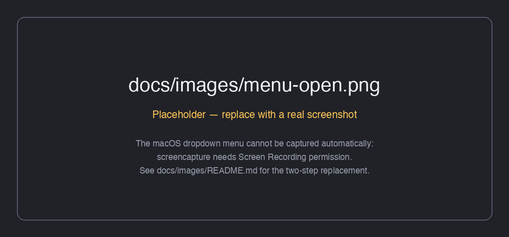
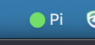
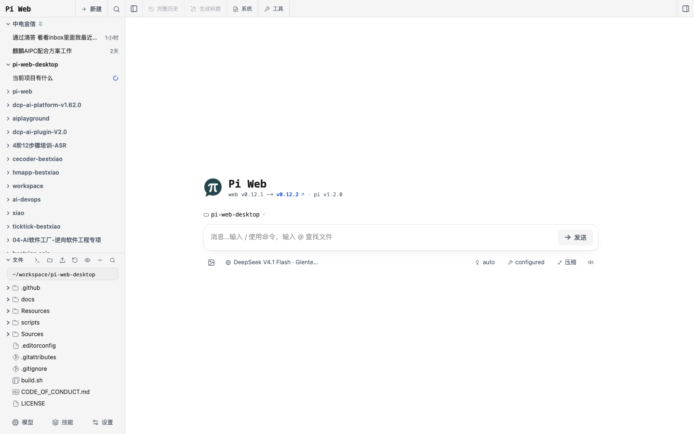

# Pi Web Desktop (macOS)

一个极小的原生 macOS 菜单栏启动器，用于 **pi-web** Web UI：无需终端即可探测、复用、启动、打开并停止本地 `pi-web` 实例。

[English](README.md) · **简体中文**

[](https://github.com/bestxia0/pi-web-desktop-macos/actions/workflows/ci.yml)
[](LICENSE)
[](#requirements)
[](#requirements)
[](#requirements)
[](https://github.com/bestxia0/pi-web-desktop-macos/releases)



## 是什么 / 不是什么

| 是什么 | 不是什么 |
| --- | --- |
| 一个原生的 Swift + AppKit `NSStatusItem` 菜单栏应用（`LSUIElement`，无 Dock 图标） | 不是 webview 或 Electron 外壳——不内嵌任何浏览器引擎 |
| 一个**纯启动器**：为你查找、启动并停止 `pi-web` CLI | 不是打包器——从不附带 Node、npm 或 `pi-web` 包 |
| 本地 `127.0.0.1` 上上游 `pi-web` 服务的前端 | 不是 `pi-web` 的替代品；CLI 与 `node` 必须已安装 |
| 一个**零依赖**、仅由 `swiftc` 构建的应用 | 不依赖 SPM、CocoaPods 或任何第三方包 |

> **运行时依赖：** 全局安装的 `pi-web` CLI 以及 `node`。本应用仅是启动器——它不内嵌 webview，也不打包 Node。

## 功能特性

- **原生菜单栏** —— 单个 `NSStatusItem`，使用 SF Symbol 加简短的 `Pi` 标题，按状态着色（运行绿色 / 忙碌橙色 / 失败红色），且没有 Dock 图标。
- **先探测，再复用** —— 每次启动都执行与 `pi-web` 相同的运行记录契约，附加到健康的既有实例，而不是再启动一个。
- **按需启动** —— 在空闲端口上启动 `pi-web --port <N> --no-open`，等待 URL 响应（最长 60 秒），然后打开界面。
- **浏览器应用模式** —— 以 Chrome 系浏览器的应用模式（无地址栏）打开界面，失败时回退到默认浏览器。
- **两种停止路径** —— 由本壳启动的实例走 `SIGINT → SIGTERM → SIGKILL` 升级；附加实例在确认提示后通过上游 `pi-web stop --port N` 停止。
- **端口回退** —— 用 `bind()` 探测 `30141`，从 `30151` 向上扫描，最后回退到内核分配的临时端口，因为 `pi-web` 本身没有回退。
- **适配 Finder 的 PATH 解析** —— 一次性恢复登录 shell 的 `PATH` 与 `pi-web` 位置，使 GUI 启动也能找到 Homebrew 的 `pi-web` 与 `node`。
- **开机自启** —— `SMAppService.mainApp` 开关，始终反映真实系统状态。
- **退出时停止后台实例的开关** —— 决定退出时是否同时停止非本壳启动的实例。
- **无头验证** —— 同一二进制无需显示即可运行 `--self-test`、`--probe`、`--test-cycle`、`--test-fallback`、`--resolve`、`--stop-port` 与 `--test-quit`。
- **版本唯一来源** —— 构建时从 `VERSION` 文件加构建日期读取；Swift 中没有任何硬编码。

## 截图


*菜单栏图标：SF Symbol 加 `Pi` 标题，按启动器状态着色。*


*完整菜单：打开、启动、停止、刷新、日志、开机自启、退出行为以及版本行。*


*Finder / 启动台中的应用图标，构建时由 `Resources/AppIcon.jpg` 生成。*


*在浏览器应用模式下打开的 `pi-web` 界面。*

## 环境要求

- **macOS 13.0 或更高版本**（`LSMinimumSystemVersion` 为 `13.0`；`SMAppService` 需要 macOS 13）。
- **Xcode Command Line Tools**，提供 `swiftc` —— 唯一需要的构建工具。
- 要真正启动服务：`PATH` 上需有**全局安装的 `pi-web` CLI** 与 **`node`**。

无 SPM、无 CocoaPods、无第三方包。应用仅用 `swiftc` 对接系统框架（Foundation、AppKit、ServiceManagement、UniformTypeIdentifiers）编译。

## 快速开始

```sh
git clone https://github.com/bestxia0/pi-web-desktop-macos.git
cd pi-web-desktop-macos
./build.sh                 # swiftc + 组装 build/PiWeb.app + ad-hoc 签名
open build/PiWeb.app
```

`./build.sh --run` 一步完成构建并启动。应用随后出现在菜单栏中，首次启动时会探测/附加或启动一个 `pi-web` 实例并打开界面。

## 安装到 /Applications

`SMAppService.mainApp` 需要稳定的 bundle 位置，因此在启用开机自启前先把应用安装到 `/Applications`：

```sh
./scripts/install.sh       # 构建、复制到 /Applications/PiWeb.app 并重新注册
# 或等价地：
make install
```

`make uninstall` 会移除 `/Applications/PiWeb.app`。开发者快捷命令包括 `make help`、`build`、`run`、`install`、`uninstall`、`verify`、`clean`、`version` 与 `log`。

## 使用

菜单项以简体中文显示。下表按从上到下的顺序列出。

### 菜单参考

| 菜单项 | 作用 | 状态 / 条件 |
| --- | --- | --- |
| `Pi Web — <detail>` | 菜单顶部的状态标题；显示当前阶段、活动 URL/版本或实例数量。 | 始终存在，禁用（仅显示）。 |
| `错误：<message>` | 展示最近一次失败（换行会压成一行）。 | 仅在存在错误时出现。 |
| 打开 Pi Web | 在 Chrome/Edge/Brave/Arc 应用模式窗口（无地址栏）中打开活动 URL，否则用默认浏览器。快捷键 `O`。 | 仅在已知活动实例 URL 时可用。 |
| 启动 Pi Web | 先探测；附加到既有实例，否则在空闲端口以 `--no-open` 启动一个并打开。快捷键 `S`。 | 仅在启动器已停止或失败时可用。 |
| 停止 Pi Web | 停止实例。自有 → `SIGINT → 10s → SIGTERM → 5s → SIGKILL`；附加 → 确认提示后执行上游 `pi-web stop --port N`。 | 恰好有一个活动实例时可用。有多个时变为 `停止 Pi Web（N 个实例）` 并带逐实例子菜单（自有项显示 `<url>  pid <pid>（本壳）`）。 |
| 刷新状态 | 重新执行探测并重建菜单。快捷键 `R`。 | 始终可用。 |
| 打开日志 | 打开 `~/Library/Logs/PiWeb/pi-web.log`。快捷键 `L`。 | 始终可用。 |
| 在 Finder 中显示日志 | 在 Finder 中显示日志文件。 | 始终可用。 |
| 开机自启 | 通过 `SMAppService.mainApp` 注册/注销登录项。 | 复选框反映真实状态；需要批准时标题为 `开机自启（需在系统设置中批准）`，bundle 未安装时为 `开机自启（App 需位于 /Applications）`；不支持时以 `开机自启不可用：<reason>` 显示并禁用。 |
| 退出时同时停止后台 pi-web | 切换退出时是否同时停止附加实例。持久化于 UserDefaults 键 `PiWebStopAttachedOnQuit`。 | 复选框，默认**开启**。始终可用。 |
| 退出 Pi Web | 停止自有子进程（开关开启时还包括所有附加实例），然后退出。快捷键 `Q`。 | 始终可用。 |
| `V<semver>-<builddate>` | 启动器版本，例如 `V0.5.0-20261019`。 | 始终存在，禁用（仅显示），最后一行。 |

### 状态图标

状态图标由 `MenuController.updateIcon()` 绘制：一个 SF Symbol 加简短标题 `Pi`，按状态着色。

| 状态 | 符号 | 颜色 |
| --- | --- | --- |
| 运行中 | `play.circle.fill` | 绿色 |
| 启动 / 停止中（忙碌） | `arrow.triangle.2.circlepath` | 橙色 |
| 已停止 | `power.circle.fill` | 标签色 |
| 失败 | `exclamationmark.triangle.fill` | 红色 |

## 无头与验证标志

同一二进制支持无头标志，因此无需显示即可验证探测、启动/停止与端口回退：

```sh
BIN=build/PiWeb.app/Contents/MacOS/PiWeb

$BIN --self-test                                # 断言：运行记录解析 + 过期记录逻辑 + PATH/node 解析
$BIN --probe                                    # 打印每条运行记录及其分类与附加/启动决策
$BIN --test-cycle --port 30199                  # 在 30199 启动，等待就绪，然后停止
$BIN --test-cycle --occupy --port 30199         # 占用 30199，然后在回退端口（30151）启动
$BIN --test-cycle --gui-path --port 30199       # 端到端模拟 LaunchServices（系统默认）PATH
$BIN --test-fallback --port 30199               # 显示 30199 被占用时规划器选择的端口
$BIN --open-url http://127.0.0.1:30141          # 打开应用模式窗口
$BIN --resolve [--gui-path]                     # 打印解析出的 pi-web + 来源 + 子进程 PATH + node
$BIN --stop-port 30199                          # 通过上游 `pi-web stop --port 30199` 停止一个实例
$BIN --test-quit --port 30199                   # 演练 stopForQuit（附加实例被停止）
$BIN --test-quit --port 30199 --keep-attached   # 同上，但开关关闭
$BIN --port 30199                               # 覆盖首选端口
$BIN --version                                  # 打印菜单底行显示的确切字符串
$BIN --log-path                                 # 打印日志文件路径
```

> `--stop-port`、`--test-cycle`、`--test-fallback` 与 `--test-quit` **仅用于验证**，不属于正常菜单流程。`--test-cycle` 绝不触碰 `30141` 实例：它只对自己启动的子进程发信号。

### 标志参考

| 标志 | 作用 | 说明 |
| --- | --- | --- |
| `--self-test` | 运行内置断言（运行记录解析、过期记录、孤儿处理、PATH/node 解析、停止命令、停止菜单、版本组合）。 | 任一检查失败则以非零退出。仅用于验证。 |
| `--probe` | 打印每条运行记录及其第 2/3 步分类，以及附加/启动决策。 | 只读；从不删除记录。仅用于验证。 |
| `--test-cycle [--occupy] [--gui-path]` | 针对一次性实例执行完整的启动 → 就绪 → 停止循环。 | `--occupy` 预先占用首选端口以演练回退；`--gui-path` 强制使用系统默认 PATH。仅用于验证。 |
| `--test-fallback` | 占用首选端口并报告规划器会选择的回退端口。 | 仅用于验证。 |
| `--open-url <url>` | 以应用模式或默认浏览器打开 URL，并打印所用命令。 | —— |
| `--resolve [--gui-path]` | 打印解析出的 `pi-web`、其来源、子进程 PATH、`node`、运行目录与浏览器计划。 | `--gui-path` 绕过所有缓存并强制探测。 |
| `--stop-port <n>` | 通过上游 `pi-web stop --port n` 停止一个实例，并打印停止前后的探测结果。 | 仅用于验证。 |
| `--test-quit [--keep-attached]` | 演练 `stopForQuit`，范围限定为 `--port`。 | `--keep-attached` 模拟开关关闭。仅用于验证。 |
| `--port <n>` | 覆盖首选端口。 | 也可通过 `PI_WEB_DESKTOP_PORT` 设置；`--port` 优先。 |
| `--version` | 打印菜单底行显示的版本字符串。 | —— |
| `--log-path` | 打印日志文件路径。 | —— |

## 探测机制（复用 pi-web 契约）

运行记录位于 `<agentDir>/pi-web-run/<launcherPid>.json`，其中 `agentDir` 为 `PI_CODING_AGENT_DIR`（展开 `~` / `~/` / `file://`）或 `~/.pi/agent`。本壳复用 pi-web 的确切格式，并镜像 `bin/run-records.js`：

1. 读取所有 `*.json`。
2. 校验 `pid` 存活（`kill(pid,0)`；`EPERM` 也算存活）**并且**该进程确实属于我们（`ps -ww -p <pid> -o args=`；启动器参数包含 `pi-web`，next 参数包含 `next`）。启动器已消失但 `nextPid` 仍存活的记录称为*孤儿*记录。
3. **只有到这一步**才探测 URL（任何 HTTP 状态码都算响应，超时 2 秒）。

顺序很重要：过期记录可能指向一个仍然响应的 URL，因为该端口由另一个实例占用，所以必须先做进程检查。

本壳刻意让探测保持**只读**——不同于 pi-web 自己的 `listRunRecords`，它在探测期间从不删除过期记录。过期记录只是被忽略。

## 端口选择

`pi-web` 没有端口回退：端口被占用时它会以 "Next.js exited unexpectedly" 退出。因此本壳在启动前先选定端口：

1. 用 `bind()` 探测 `127.0.0.1:30141` —— 空闲则使用。
2. 否则从 `30151` 向上扫描（最多 500 次），取第一个空闲端口。
3. 否则通过绑定端口 `0` 向内核申请一个临时端口。

## 停止

每条实例走两条路径之一：

- **自有**（由本壳启动）：Next.js 会保持 SSE 连接打开，其 `instrumentation-node.ts` 会在 SIGINT/SIGTERM 时关闭它们。本壳**先发 SIGINT**，最多等 10 秒，然后 SIGTERM（5 秒），最后 SIGKILL。
- **附加**（在别处启动）：本壳委托上游命令 `pi-web stop --port N`，始终带 `--port`（不带时，上游在多个实例运行时出错）。上游已处理孤儿记录、pid 复用归属校验与运行记录清理，因此这里的 kill 逻辑从不重复实现。使用解析出的登录 shell PATH，使 `node` 与 `pi-web` 能解析。该路径具有破坏性，因此会先请求确认。

任何停止之后本壳都会重新探测并重新发布状态，因此菜单始终反映现实。失败（超时 / 非零退出码）会以红色失败状态加命令输出呈现。

退出时，`退出时同时停止后台 pi-web` 开关决定是否也停止附加实例；自有子进程始终会被停止。

| 路径 | 机制 | 升级阶梯 | 确认 |
| --- | --- | --- | --- |
| 自有 | 直接向启动的子进程发信号 | `SIGINT`（10s）→ `SIGTERM`（5s）→ `SIGKILL` | 无 |
| 附加 | `pi-web stop --port N` | 由上游处理 | 有，模态警告 |

## 日志

仅追加的日志位于 `~/Library/Logs/PiWeb/pi-web.log`。启动的 `pi-web` 的 stdout 与 stderr 都会重定向到同一文件，启动失败会在文件尾部留下原因。菜单提供 `打开日志` 与 `在 Finder 中显示日志`；`make log` 可跟踪该文件。

## 应用图标

bundle 图标来自 `Resources/AppIcon.jpg`，由 `build.sh` 通过 `sips` + `iconutil` 转换为 `Contents/Resources/PiWeb.icns`（全部十个必需尺寸，`CFBundleIconFile` = `PiWeb`）。

源图仅为 282x267 且非正方形，因此先**居中裁剪**为正方形：不拉伸、不补色带。由于源图太小，512 与 1024 条目是放大得到的，看起来偏软。在同一路径放入至少 1024x1024 的正方形源图并重新构建即可解决；无需改动代码。

这只改变*应用*图标（Finder、启动台、显示简介）。**菜单栏状态图标不受影响**——它仍是 `MenuController.updateIcon()` 绘制的 SF Symbol 加 `Pi` 文本，每个状态一种外观。

## 版本

`V0.5.0-20261019` 作为菜单最后一行显示在 `退出 Pi Web` 下方，是禁用且仅用于显示的条目。它来自唯一一处：

| 来源 | 值 | 写入 Info.plist 为 |
| --- | --- | --- |
| `VERSION` 文件 | `0.5.0` | `CFBundleShortVersionString` |
| 构建时的 `date +%Y%m%d` | `20261019` | `CFBundleVersion` |
| 两者拼接 | `0.5.0-20261019` | `PiWebVersion` |

因此升级版本就是：编辑 `VERSION`，运行 `./build.sh`。Swift 中没有任何硬编码，日期也从不手工维护。

`VersionInfo` 从 bundle 读回该键并加上前缀 `V`；在构建产物之外则回退为 `V0.0.0-dev`，而不是显示空白。`--version` 打印完全相同的字符串。未来的更新检查会将 `CFBundleShortVersionString` 与最新发布的 release 比较；按设计目前尚无网络代码。

## 配置与偏好

### UserDefaults 键

存储在 bundle 域 `com.piweb.desktop` 中。可用 `defaults write com.piweb.desktop <key> <value>` 设置。

| 键 | 类型 | 默认值 | 作用 |
| --- | --- | --- | --- |
| `PiWebStopAttachedOnQuit` | Bool | `true` | `退出 Pi Web` 是否也停止附加实例。可在菜单中切换。 |
| `PiWebExecutablePath` | String | 未设置 | `pi-web` 可执行文件的显式路径；发现优先级最高。 |
| `PiWebLoginShellPATH` | String | 未设置 | 一次性登录 shell 探测捕获并缓存的 `PATH`。 |
| `PiWebLoginShellPiWeb` | String | 未设置 | 从登录 shell 捕获并缓存的 `pi-web` 路径。 |

### 环境变量

由于 GUI 启动不会继承登录 shell，应用会用 `/bin/zsh -lic 'command -v pi-web; echo "$PATH"'`（超时 5 秒）向登录 shell 询问一次，将结果缓存到 UserDefaults，并回退扫描 `/opt/homebrew/bin`、`/usr/local/bin`、`~/.local/bin`、`~/.bun/bin`、`~/.npm-global/bin` 以及 `npm prefix -g`。显式路径始终优先。

| 变量 | 默认值 | 作用 |
| --- | --- | --- |
| `PI_WEB_DESKTOP_EXECUTABLE` | 未设置 | 显式 `pi-web` 可执行文件；优先于发现（仅次于 `PiWebExecutablePath`）。 |
| `PI_CODING_AGENT_DIR` | `~/.pi/agent` | 存放 `pi-web-run/` 的 agent 目录；会展开 `~`、`~/` 与 `file://`。 |
| `PI_WEB_DESKTOP_PORT` | `30141` | 首选端口覆盖；`--port` 优先于它。 |
| `HOME` | 用户主目录 | `~` 展开以及日志 / 支持目录的基路径。 |

GUI 启动时，应用先探测，再附加或启动，然后打开窗口；它从不启动第二个实例。双击已在运行的应用会发送 `com.piweb.desktop.activate` 分布式通知，弹出正在运行实例的菜单，因此该操作从不悄无声息。

## 故障排查

| 现象 | 可能原因 | 修复 |
| --- | --- | --- |
| 应用已启动但菜单栏没有图标 | 图标被菜单栏溢出区 / 刘海遮挡，或已有另一实例持有单实例锁。 | 检查菜单栏溢出区与活动监视器中的 `PiWeb`；再次启动应用可让运行中的实例显示出来（它会发送 `com.piweb.desktop.activate`）。查看 `~/Library/Logs/PiWeb/pi-web.log`。 |
| 从 Finder 启动后提示 "pi-web not found" | LaunchServices 只给应用 `/usr/bin:/bin:/usr/sbin:/sbin`，且登录 shell 探测失败或超时（`.zshrc` 太慢）。 | 全局安装 `pi-web`，用 `/bin/zsh -lic 'command -v pi-web'` 验证，然后设置 `PiWebExecutablePath` 或 `PI_WEB_DESKTOP_EXECUTABLE`。用 `--resolve` / `--probe` 诊断。 |
| 首选端口被占用 | `pi-web` 本身没有回退，会以 "Next.js exited unexpectedly" 退出；本壳已回退。 | 让本壳使用 `30151+` 或临时端口；在状态标题中查看活动 URL。用 `停止 Pi Web` 或 `--probe` 找到并停止过期实例。 |
| 第二次启动看似毫无反应 | LaunchServices 会去重 bundle 启动；已在运行的实例收到激活通知并弹出自己的菜单。 | 点击菜单栏图标。若仍无反应，通过日志与状态标题确认运行中的实例。 |
| 开机自启项指向仓库目录 | `.app` bundle 不在 `/Applications`，因此 `SMAppService.mainApp` 注册了仓库路径。 | 先运行 `./scripts/install.sh` 或 `make install`，再启用 `开机自启`；在此之前菜单会显示 `开机自启（App 需位于 /Applications）`。 |
| pi-web 界面在默认浏览器而不是应用模式中打开 | 在 `/Applications` 下未找到四个规范的 Chrome 系应用。 | 在 `/Applications` 中安装 Google Chrome、Microsoft Edge、Brave 或 Arc，或接受默认浏览器。 |

## 已知限制

- **未测试：** 在此环境中未开启 `开机自启`（`SMAppService.mainApp`），因为 bundle 目前位于仓库内，注册会创建一个指向该处的登录项。菜单反映 `SMAppService` 返回的真实状态。
- 浏览器探测只检查四个规范的 `/Applications` 路径（Chrome、Edge、Brave、Arc）；非标准安装位置会回退到默认浏览器。
- 探测是只读的，且从不清理过期记录（有意为之）。注意*附加*停止路径会调用 `pi-web stop`，上游会在该命令中清理过期记录。
- 本壳仅在内存中跟踪归属；本壳崩溃后，它先前启动的实例在重启后会变成附加实例（仍可停止，此时通过 `pi-web stop`）。
- `--stop-port`、`--test-cycle`、`--test-fallback` 与 `--test-quit` 用于验证，不属于正常菜单流程。
- 第二次启动触发的屏幕菜单弹出在无头测试会话中未能截图（macOS 没有为该配件应用渲染程序化弹出菜单）；显示代码路径会执行，菜单内容由 `menu build:` 日志行与自检覆盖。

## 项目结构

```text
pi-web-desktop-macos/
├── Sources/                    由 swiftc 编译的 Swift 源码（无 SPM）
│   ├── main.swift              入口 + 无头验证模式 + 单实例锁
│   ├── MenuController.swift    NSStatusItem 菜单、图标与菜单动作
│   ├── StatusController.swift  探测 / 启动 / 停止编排与 UI 状态
│   ├── ProcessManager.swift    pi-web 解析、子进程启动、就绪等待、信号升级
│   ├── RunRecords.swift        运行记录解析、校验顺序与分类
│   ├── PortPlanner.swift       bind() 探测、回退扫描与临时端口
│   ├── EnvironmentResolver.swift 登录 shell 探测与子进程 PATH 组装
│   ├── BrowserOpener.swift     Chrome 系应用模式打开与默认浏览器回退
│   ├── PiWebCommands.swift     上游 `pi-web stop --port N` 调用
│   ├── LoginItem.swift         SMAppService.mainApp 开机自启
│   ├── Preferences.swift       基于 UserDefaults 的偏好
│   ├── StopMenu.swift          可测试的逐实例停止子菜单模型
│   ├── VersionInfo.swift       VERSION + 构建日期组合与显示
│   ├── Logger.swift            仅追加的文件日志
│   ├── AppConfig.swift         常量与 agent 目录解析
│   ├── HTTPProbe.swift         HTTP 存活探测
│   └── SelfTest.swift          `--self-test` 断言
├── Resources/AppIcon.jpg       应用图标源图（构建时居中裁剪）
├── docs/
│   ├── ARCHITECTURE.md         启动器的设计说明
│   └── images/                 本 README 使用的截图
├── scripts/
│   ├── install.sh              构建、复制到 /Applications 并重新注册
│   ├── verify.sh               无头验证套件（make verify）
│   └── capture-screenshots.sh  重新生成 docs/images 截图
├── .github/                    CI 工作流（ci.yml）与 issue 模板
├── build.sh                    swiftc 构建、.app 组装与 ad-hoc 签名
├── Makefile                    help / build / run / install / uninstall / verify / clean / version / log
├── VERSION                     写入 Info.plist 的语义化版本
├── CHANGELOG.md                发布历史
├── CONTRIBUTING.md             贡献指南
├── SECURITY.md                 安全策略
├── CODE_OF_CONDUCT.md          贡献者公约
└── LICENSE                     MIT
```

`build/` 是生成产物，不纳入版本控制。

## 开发

```sh
./build.sh              # 编译 + 组装 build/PiWeb.app + ad-hoc 签名
./build.sh --run        # 构建并启动
make verify             # 运行无头验证套件（scripts/verify.sh）
./scripts/verify.sh     # 直接运行同一套件
```

`make verify` 会构建应用并运行上述无头模式。贡献流程见 [CONTRIBUTING.md](CONTRIBUTING.md)，探测、端口选择、停止与环境解析的设计见 [`docs/ARCHITECTURE.md`](docs/ARCHITECTURE.md)。发布历史见 [CHANGELOG.md](CHANGELOG.md)。

## 路线图

- [ ] 公证并签名的发布构建（Developer ID + `notarytool`）。
- [ ] 针对最新 GitHub release 的更新检查。
- [ ] 1024x1024 的正方形源图，去除偏软的 512/1024 放大条目。
- [ ] 在 macOS runner 上由 CI 运行集成循环（`--test-cycle`）。
- [ ] Homebrew tap / cask。

## 贡献

欢迎贡献。请先阅读 [CONTRIBUTING.md](CONTRIBUTING.md) 与 [CODE_OF_CONDUCT.md](CODE_OF_CONDUCT.md)，并按照 [SECURITY.md](SECURITY.md) 报告漏洞。提交 PR 前请运行 `make verify`。

## 许可证

基于 [MIT License](LICENSE) 发布。Copyright (c) 2026 bestxia0。

## 致谢

本启动器是上游 **pi-web** 项目（`@agegr/pi-web`）的轻量前端，复用了它的运行记录格式、`pi-web stop --port N` 命令与端口行为。感谢 pi-web 的作者与 Pi 社区。
